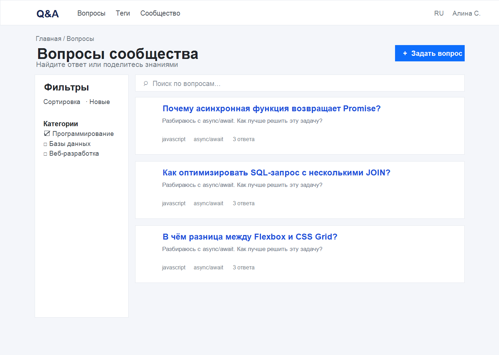
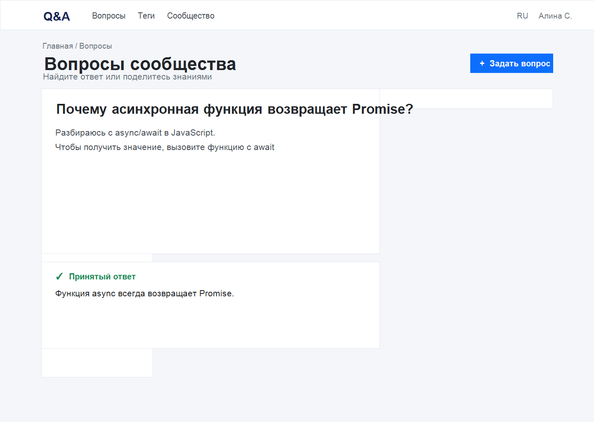
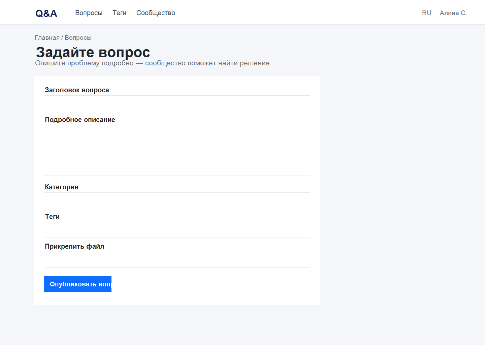
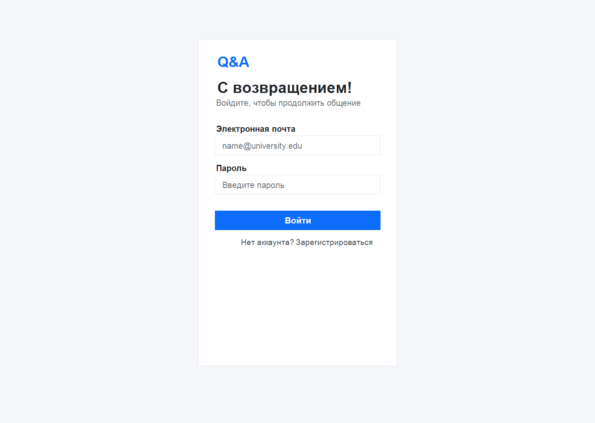
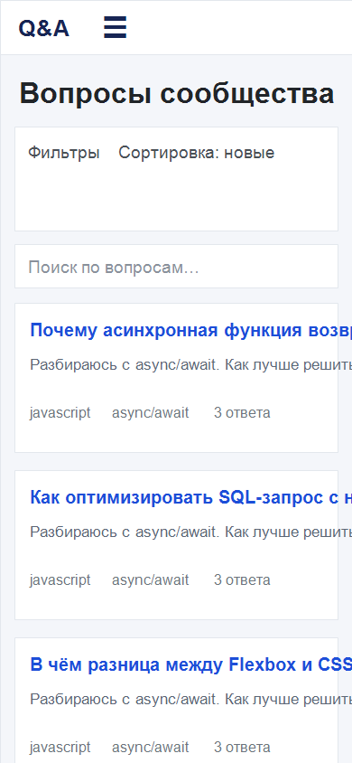

# UI-kit: Student Q&A Platform

**Figma:** создать файл `Student Q&A — дизайн` в своём аккаунте и вставить сюда ссылку с доступом «Anyone with the link — can view».
**Прототип:** ссылка на Figma Present после настройки переходов.

> Экранные макеты и стили подготовлены в репозитории как основа для переноса в Figma. Исходный кликабельный HTML предпросмотр: [prototype.html](prototype.html). Ссылка на Figma и прототип требуют авторизации владельца аккаунта и здесь пока не опубликованы.

## Основа и сценарии

- **US-01 — задать вопрос:** `/login` → `/questions` → `/questions/create` (`/ask`) → опубликовать → `/questions/{question}`. Ошибочная форма показывает состояние валидации и сохраняет введённые данные.
- **US-02 — ответить и принять ответ:** `/questions` → `/questions/{question}` → написать ответ (`POST /questions/{question}/answers`) → автор вопроса принимает ответ (`POST /answers/{answer}/accept`).
- Маршруты сверены с `routes/web.php`; пользовательские истории — `docs/03-short-spec/03-short-spec.md`.

## Сетка и отступы

- Desktop 1440: 12 колонок, контент 1240 px, поля по 100 px, gutter 24 px. Список: боковая панель 3 колонки, контент 9 колонок.
- Mobile 390: 4 колонки, поля 16 px, gutter 16 px. Фильтры размещены над результатами.
- Шаг отступов: 4 / 8 / 12 / 16 / 24 / 32 px. Кнопки и поля не ниже 44 px.

## Цвета

| Стиль | HEX | Назначение |
|---|---|---|
| color/primary | #0D6EFD | Основные действия, ссылки (`--bs-primary`) |
| color/success | #198754 | Принятый ответ, успешные состояния (`--bs-success`) |
| color/warning | #FFC107 | Предупреждение; использовать тёмный текст (`--bs-warning`) |
| color/danger | #DC3545 | Ошибки и destructive-действия (`--bs-danger`) |
| color/text | #212529 | Основной текст (`--bs-body-color`) |
| color/muted | #6C757D | Вторичные подписи (`--bs-secondary-color`) |
| color/border | #DEE2E6 | Рамки (`--bs-border-color`) |
| color/bg | #F4F6FA | Фон экранов (переопределить `--bs-body-bg`) |

## Типографика

Noto Sans (кириллица): `text/h1` 32/40 SemiBold; `text/h2` 24/32 SemiBold; `text/body` 16/24 Regular; `text/small` 14/20 Regular.

## Компоненты

- **Button:** Primary / Secondary / Danger × Default / Hover / Disabled; высота 44 px, радиус 7 px, горизонтальный padding 16 px. Bootstrap: `.btn`, `.btn-primary`, `.btn-outline-secondary`, `.btn-danger`.
- **Input:** Default / Focus / Error / Disabled; высота 46 px, подпись у каждого поля, рамка 1 px, радиус 7 px. Bootstrap: `.form-control`, `.is-invalid`.
- **QuestionCard:** Auto Layout; счёт голосов, заголовок, описание, теги, автор и метаданные. Bootstrap: `.card` + flex/grid.
- **AnswerCard:** состояние принятого ответа содержит и текст «Принятый ответ», и значок.

## Экраны

Макеты PNG экспортированы из интерактивного предпросмотра. В Figma импортируйте `prototype.html` как визуальный референс и соберите отдельные страницы `01 Flow`, `02 Wireframes`, `03 UI-kit`, `04 Mockups` с нативными компонентами и вариантами.

## Доступность

Размер базового текста 16 px, подписи полей видимы, элементы управления имеют высоту от 44 px. Принятый ответ отмечен подписью и значком, статус не передаётся только цветом. Контрастные значения для ключевых пар: белый / `#0D6EFD` ≈ 4.50:1; `#6C757D` / белый ≈ 4.69:1; `#212529` / `#FFC107` ≈ 9.4:1. Белый на жёлтом не используется.

## Перед сдачей

В Figma создайте библиотеку стилей и компонентов из таблиц выше, свяжите экраны переходами (минимум 5), задайте `/login` стартовой точкой и overlay после отправки вопроса. Вставьте опубликованные Figma и Present ссылки в начало файла. Создайте тег `lab-09` после добавления документации и экспортов.
